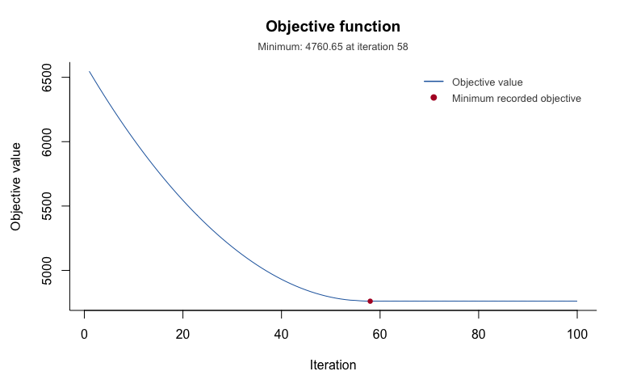
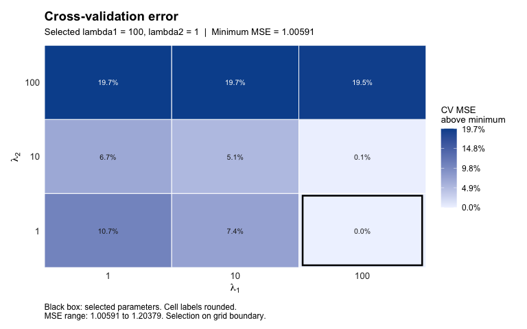

<!-- README.md is generated from README.Rmd. Please edit that file -->
<!-- badges: start -->

[](https://CRAN.R-project.org/package=learner)
[](https://github.com/stmcg/learner/actions/workflows/R-CMD-check.yaml)
[](https://app.codecov.io/gh/stmcg/learner)
<!-- badges: end -->

# learner

The `learner` package implements transfer learning methods for low-rank
matrix estimation. These methods use similarity in the latent row and
column spaces of source and target populations to improve estimation in
the target population. The methods include LatEnt spAce-based tRaNsfer
lEaRning (LEARNER) and direct projection LEARNER (D-LEARNER), described
by [McGrath et al. (2024)](https://doi.org/10.48550/arXiv.2412.20605).

## Installation

Install the released version from CRAN:

``` r
install.packages("learner")
```

Install the latest version from GitHub:

``` r
# install.packages("devtools")
devtools::install_github("stmcg/learner")
```

The multiple-source features and plotting functions below are not in the
CRAN release yet; install the GitHub version to run these examples.
`plot_cv()` also requires ggplot2 (version 3.4.0 or later), which is
optional for fitting and for the other plots:

``` r
install.packages("ggplot2")
```

## One source population

`dat_highsim` contains a simulated source and target with similar latent
spaces. LEARNER fits the target while penalizing departures from the
source spaces. Here `lambda_1` controls both space penalties, and
`lambda_2` controls the balance between the two target factors.

``` r
library(learner)
fit_single <- learner(
  Y_source = dat_highsim$Y_source, Y_target = dat_highsim$Y_target,
  r = 3, lambda_1 = 10, lambda_2 = 1, step_size = 0.003,
  control = list(max_iter = 2000)
)
dim(fit_single$learner_estimate)
#> [1] 100  50
```

`plot_objective()` shows the recorded objective values. With
`iterations = "near_optimum"` it zooms in on the iterations around the
smallest value; the default `iterations = "all"` shows the full history,
and a vector such as `1:500` shows a specific range.

``` r
plot_objective(fit_single, iterations = "near_optimum")
```

<div class="figure">


<p class="caption">
Objective function values near the optimum for the single-source fit.
</p>

</div>

D-LEARNER projects the target data directly onto the source spaces,
without iterative optimization or penalty selection:

``` r
direct_single <- dlearner(dat_highsim$Y_source, dat_highsim$Y_target, r = 3)
```

## Multiple sources and separate penalties

`dat_multisource` contains one target and two sources, each with 100
rows and 50 columns. The true signals have rank 3 and share their latent
spaces. Independent normal noise is added to each population: the noise
variances are 0.10 for the target, 0.01 for source A, and 0.50 for
source B. The true signal matrices are also included, but are not needed
for fitting.

Pass the sources as a list. The weights below are illustrative choices;
they are held fixed during cross-validation. Larger row or column
penalties encourage the corresponding target factors to follow the
combined source spaces more closely.

``` r
sources <- dat_multisource$Y_source
target <- dat_multisource$Y_target
weights <- c(0.7, 0.3)
row_grid <- c(0, 1, 10)
col_grid <- c(0, 1, 3)
balance_grid <- c(0.1, 1)
```

Select penalties by cross-validation. This small grid and iteration
budget keep the example quick; use suitable grids and optimization
settings for an analysis.

``` r
set.seed(815)
cv <- cv.learner(
  Y_source = sources, Y_target = target, r = 3, source_weights = weights,
  lambda_1_row_all = row_grid, lambda_1_col_all = col_grid,
  lambda_2_all = balance_grid, n_folds = 3, step_size = 0.0003,
  control = list(max_iter = 2000)
)
c(row = cv$lambda_1_row_min, column = cv$lambda_1_col_min,
  balance = cv$lambda_2_min)
#>     row  column balance
#>      10       3       1
```

For a common space penalty, supply `lambda_1_all` instead of the
separate row and column grids. Cross-validation selects penalties, not
the rank or source weights.

### Cross-validation results

The heatmap shows how much the CV error increases above its minimum,
with a black box marking the selected combination. Supplying
`n_observed` converts the stored sums of squared errors to mean squared
errors (MSE).

``` r
plot_cv(
  cv, lambda_1_row_all = row_grid, lambda_1_col_all = col_grid,
  lambda_2_all = balance_grid, n_observed = sum(!is.na(target))
)
```

<div class="figure">


<p class="caption">
Cross-validation error across the candidate penalties.
</p>

</div>

A selected value on a grid boundary can be a reason to expand that grid.
Here all three selected values are at the upper end of their grids; the
grids are kept small to keep the example quick, but an analysis would
expand them. CV scores can also come from fits that reached the
iteration limit, so inspect the optimization settings before
interpreting the selection.

### Refit with the selected penalties

Refit using the selected penalties and all observed target entries:

``` r
fit <- learner(
  Y_source = sources, Y_target = target, r = cv$r, source_weights = weights,
  lambda_1_row = cv$lambda_1_row_min,
  lambda_1_col = cv$lambda_1_col_min, lambda_2 = cv$lambda_2_min,
  step_size = 0.0003, control = list(max_iter = 2000)
)
fit$convergence_criterion
#> [1] 1
```

The stopping code `1` means that the objective-change threshold was met
(`2`: the iteration limit was reached; `3`: excessive objective growth
or a non-finite update; see `?learner`).

D-LEARNER accepts the same source list and weights:

``` r
direct <- dlearner(sources, target, r = 3, source_weights = weights)
dim(direct$dlearner_estimate)
#> [1] 100  50
```

### Compare source choices

For this simulated dataset, the true target signal is available. Compare
D-LEARNER fits at the same rank to isolate the choice of source spaces,
together with the truncated SVD of the target alone as a baseline:

``` r
estimates <- list(
  Target_only = dlearner(target, target, r = 3)$dlearner_estimate,
  A_only = dlearner(sources$A, target, r = 3)$dlearner_estimate,
  B_only = dlearner(sources$B, target, r = 3)$dlearner_estimate,
  Weighted_A_B = direct$dlearner_estimate
)
source_errors <- vapply(estimates, function(estimate) {
  norm(estimate - dat_multisource$Theta_target, "F")
}, numeric(1))
round(source_errors, 3)
#>  Target_only       A_only       B_only Weighted_A_B
#>        6.238        2.323       17.214        5.324
```

Lower Frobenius error is better. In this example, source A alone gives
the smallest error. The weighted combination improves on the target
alone, while source B alone is worse than ignoring the sources. The
weights 0.7/0.3 are illustrative, not optimized. These results describe
one simulated dataset; they are not CV errors or evidence that combining
sources always improves estimation.

### When both sources are noisy

A second setting keeps the same true signals but generates new
independent noise with variances 0.10 for the target, 0.25 for A, and
0.50 for B. The built-in `dat_multisource` data are unchanged. Rank and
weights remain fixed at 3 and 0.7/0.3, respectively.

``` r
# Reuse the true signals, with new independent noise for every population.
set.seed(20261016)
add_noise <- function(signal, variance) {
  signal + matrix(rnorm(length(signal), sd = sqrt(variance)),
                  nrow(signal), ncol(signal))
}
target_noisy <- add_noise(dat_multisource$Theta_target, variance = 0.10)
sources_noisy <- list(
  A = add_noise(dat_multisource$Theta_source$A, variance = 0.25),
  B = add_noise(dat_multisource$Theta_source$B, variance = 0.50)
)
estimates_noisy <- list(
  Target_only = dlearner(target_noisy, target_noisy, r = 3)$dlearner_estimate,
  A_only = dlearner(sources_noisy$A, target_noisy, r = 3)$dlearner_estimate,
  B_only = dlearner(sources_noisy$B, target_noisy, r = 3)$dlearner_estimate,
  Weighted_A_B = dlearner(sources_noisy, target_noisy, r = 3,
                         source_weights = c(0.7, 0.3))$dlearner_estimate
)
errors_noisy <- vapply(estimates_noisy, function(estimate) {
  norm(estimate - dat_multisource$Theta_target, "F")
}, numeric(1))
round(errors_noisy, 3)
#>  Target_only       A_only       B_only Weighted_A_B
#>        6.436       13.377       16.549       10.566
```

Here combining the sources gives a lower error than using either source
alone. However, the target-only SVD still has the smallest error.
Together, the two examples illustrate that the benefit depends on source
quality and weights; neither setting establishes that combining sources
is always preferable.

### Latent spaces and contributions

Compare the target and source spaces, or inspect which variables
contribute to the components of a fitted target matrix:

``` r
plot_source_spaces(target, sources, r = 3)
plot_contributions(fit)
```

See `?learner`, `?cv.learner`, `?dlearner`, and `?dat_multisource` for
details. More runnable examples are included in `inst/examples/` in the
source repository.
